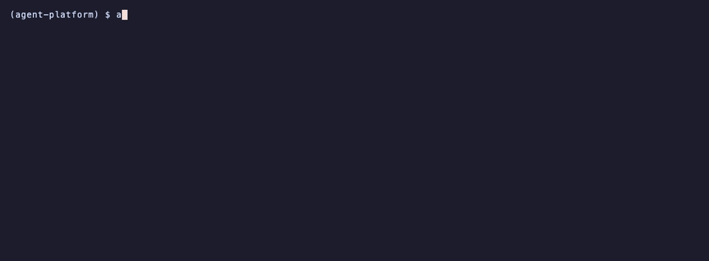
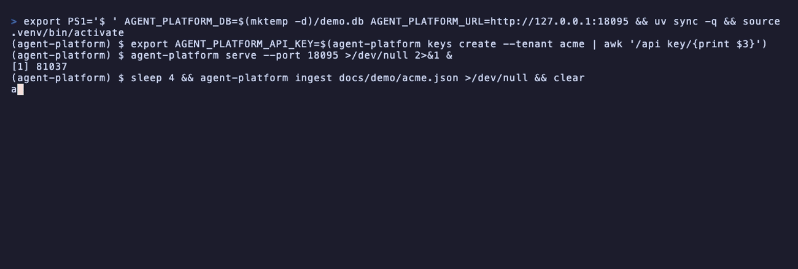

<h1 align="center">Agent Platform</h1>

<p align="center">
  <em>A service that answers each customer's questions from that customer's own documents, keeps customers' data apart, and runs multi-step research jobs that finish even when a worker process crashes.</em>
</p>

<p align="center">
  <a href="https://github.com/adeoluo/agent-platform/actions/workflows/ci.yml"></a>
  <a href="https://github.com/adeoluo/agent-platform/releases"></a>
  
  
  <a href="LICENSE"></a>
</p>

---

> **Evidence level: unit tested.** Integration tests (tests that run several parts together) cover tenant isolation, job leases, and recovery after a worker is force-stopped with SIGKILL. Throughput is measured with a deterministic offline model (fixed rules that give the same output every time, with no network), not a live large language model (LLM). No one else has reproduced the results, and the service is not used in production. [What the levels mean](https://github.com/adeoluo#evidence-levels).

## Highlights

This is a backend service that runs AI agents for many customers at once. An AI agent is a
program that uses a language model to decide which steps and tools to use to answer a
question. The service keeps each customer's data apart. It also finishes a long job even if the
worker process running it is killed.

- **A killed job continues from its last saved step.** In the recovery benchmark, a worker is
  killed in the middle of a five-step job. Another worker takes over as soon as the dead
  worker's claim on the job runs out (0.5 to 2 seconds in the benchmark). Zero saved steps are
  run again.
- **It stays steady under load.** It handled 554 requests per second for repeated questions
  and 390 for new ones, with no errors in 10,000 requests each. The server was allowed only
  256 open files, so a resource leak would have stopped the run.
- **Tests check that customers cannot see each other's data.** The tests cover documents,
  answers, jobs, traces, memories, and sessions.

**Where it falls short:** by default the "AI model" behind it is a scripted stand-in, not a
real language model. So the speed numbers measure the service, not a model. The server is one
Python process, and it stores its data in SQLite on a single machine.

## Key terms

Plain definitions of the terms used in this README.

| Term | Meaning |
|---|---|
| Abstention | Answering "could not find" when the documents do not contain the answer, instead of guessing. |
| Accuracy (substring match) | The share of questions whose answer contains the expected text. It runs from 0% to 100%; higher is better. |
| Blackboard | The orchestrator's shared record of a job: the plan, each step's output, and reviews. A saved copy of it lets a new worker continue the job. |
| Bootstrap confidence interval (CI) | The 20 results are re-sampled 10,000 times, and the 95% CI is the range holding the middle 95% of those accuracies. A narrower range is more certain. |
| Cache hit | A request that the gateway answers from its store of earlier model replies, without calling the model again. Repeated questions hit the cache; new questions miss it. |
| Checkpoint | A saved record of a finished job step and the blackboard, written to the database. After a crash, work restarts from the last checkpoint. |
| Deterministic offline policy model | The default stand-in for a language model. Fixed rules pick a calculator call, a search, or a sentence copied from a document. Its output is the same every run. |
| Fencing token | A number that grows each time a worker claims a job. The database accepts a step only with the current number, so a worker that lost its claim cannot write. |
| File descriptor | A handle the operating system gives a process for each open file or connection. A process has a fixed limit, so a leak eventually stops it. |
| Gateway | A safety layer that every model call passes through. It screens for prompt injection, hides personal data, applies an output policy, and caches replies. |
| Global interpreter lock (GIL) | A lock in standard Python that lets only one thread run Python code at a time. It limits how much one Python process can do in parallel. |
| Grounded answer | An answer that cites at least one source, where every cited source was retrieved during the run. An answer that cites nothing, or cites an unseen document, is not grounded. |
| HNSW | Hierarchical navigable small world: a graph index that quickly finds the stored vectors closest to a query vector, at the cost of being approximate. |
| Hybrid retrieval | Search that runs several methods (BM25 and TF-IDF keyword scoring, plus HNSW vector search) and merges their ranked lists into one. |
| Large language model (LLM) | An AI model, trained on large amounts of text, that reads a prompt and writes a reply. |
| Lease | A time-limited claim on a job. The worker must renew it while working. If the worker dies, the lease runs out and another worker may claim the job. |
| p50, p95, p99 latency | The time within which 50%, 95%, or 99% of requests finished. p99 shows the slowest requests. Lower is better. |
| Personally identifiable information (PII) | Data that can identify a person, such as an email address or a phone number. |
| Prompt injection | Text that tries to make a model ignore its instructions, for example "ignore all previous instructions". It can arrive in a question or inside a document. |
| ReAct agent | An agent that alternates between reasoning about the next step and acting by calling a tool, such as search or a calculator, until it can answer. |
| Regression check | A fixed set of tests run on every change to catch anything that stopped working. It is not a measure of general ability. |
| SIGKILL | An operating system signal that stops a process at once. The process gets no chance to clean up or save its work. |
| Tenant | One customer account. Each tenant has its own API keys, documents, cache, rate limit, jobs, traces, and memories. |
| Throughput | The number of requests the server handles per second. Higher is better. |
| Worker | A separate process that takes jobs from the database and runs them step by step. Several workers can run at once. |

## Motivation

This project joins nine libraries from this portfolio into one system:

- a safety gateway, which checks every call to the model
- a ReAct agent, which reasons and calls tools in turns
- a multi-agent orchestrator, in which a planner, workers, and a critic split a job into steps
- hybrid retrieval, which combines several search methods
- an HNSW index, a graph for fast vector search
- constrained decoding, which can only produce output that matches a given schema
- an evaluation harness, which runs a fixed question set and scores the answers
- a tracing library, which records each step of a request
- long-term memory

The system adds an HTTP API, durable state stored in SQLite (a database kept in a local file),
per-tenant isolation, tracing, metrics, and an evaluation suite. Everything runs offline and
gives the same output on every run. It needs only the Python standard library, NumPy (a
library for numerical arrays), and those nine libraries.

## Architecture

<p align="center">
  
</p>

<sub>Legend: amber = entry points and external systems, indigo = core logic, green = data and state, blue = validation and control, grey = observability and outputs.</sub>

Each request passes two checks before it reaches a handler. Its API key is compared with stored
hashes of valid keys. Then a per-tenant rate limit (a cap on how many requests each tenant can
send in a period) is applied. `/v1/ask` runs the ReAct agent. Every model call from the agent
passes through the tenant's safety gateway, and the agent's search tool reads the tenant's
hybrid index. `/v1/jobs` saves a durable job, which stays in the database even if a process
stops. Separate worker processes claim the job under a lease and run it through the
orchestrator. They save the blackboard as a checkpoint after every step. Spans (timed records
of each step), jobs, documents, and keys live in one SQLite file. The evaluation suite uses the
public API. [docs/ARCHITECTURE.md](docs/ARCHITECTURE.md) describes the request path and the job
lifecycle step by step, with sequence and state diagrams. Design decisions are recorded in
[docs/adr](docs/adr) (architecture decision records).

### How the libraries compose

The table lists each component, where its code lives, and what it does in the platform.

| Component | Package / Module | Role in the platform |
| --- | --- | --- |
| Safety gateway | [llm-gateway](https://github.com/adeoluo/llm-gateway) | Every model call goes through a per-tenant `Gateway`: injection screening (including retrieved text), PII redaction in and out, output policy, response cache. `TenantRateLimiter` enforces per-tenant API quotas. |
| Agent loop | [`_internal/react_core`](src/agent_platform/_internal/react_core) | `ReActAgent` drives tool use with a tenant-bound `ToolRegistry` (knowledge-base search and AST-based `CalculatorTool`). |
| Durable jobs | [`_internal/orchestrator_core`](src/agent_platform/_internal/orchestrator_core) | Planner, worker, and critic for research jobs. The `Blackboard` snapshot is the checkpoint that a replacement worker restores. |
| Retrieval | [hybrid-rag](https://github.com/adeoluo/hybrid-rag) | Sentence chunking and `HybridRetriever` fusing BM25, TF-IDF, and the HNSW retriever by reciprocal rank fusion. |
| Vector search | [ann-vector-search-library](https://github.com/adeoluo/ann-vector-search-library) | `HNSW` index over hashed embeddings, adapted to the `hybrid_rag` retriever protocol. |
| Structured output | [`_internal/schema_fsm`](src/agent_platform/_internal/schema_fsm) | Compiles a response schema to a finite automaton and decodes JSON that is valid by construction. |
| Memory | [`_internal/memory_store`](src/agent_platform/_internal/memory_store) | Per-tenant episodic, semantic, and procedural memory in SQLite with hybrid recall and fact extraction. |
| Evaluation | [evaluation-harness](https://github.com/adeoluo/evaluation-harness) | `Runner`, `Task`, and `IncludesGrader` run the fixed question set through the public API, with bootstrap confidence intervals. |
| Tracing | [llm-observability](https://github.com/adeoluo/llm-observability) | `Tracer` spans for requests, agent runs, model calls, tools, and job steps, persisted per tenant and retrievable by id. |

Small adapters in this repository connect libraries whose interfaces do not match. For
example, `GatewayModel` lets the agent use the gateway as its language model. Five standalone
public libraries are pinned to exact versions in `uv.lock`, the project's dependency lock file.
The other four are internal platform subsystems under `src/agent_platform/_internal/`.

## Results

### Infrastructure benchmarks (load and crash recovery)

These numbers come from an 8-core Apple M1. The 1-minute load average (the average number of
processes running or waiting for the processor) was 2.2 to 3.1 during the run. The benchmarks
use the deterministic offline policy model. So they measure HTTP handling, authentication,
hybrid retrieval, and SQLite time, not the time a remote LLM takes to generate text. The SQLite
time includes write-ahead logging (WAL, a mode that writes changes to a separate log first) and
lease fencing.

**Load** (`ulimit -n 256; uv run python benchmarks/load.py --requests 10000`): the server runs
as its own process. 20 tenants each have their own key and their own document set (corpus).
16 client threads send 10,000 `POST /v1/ask` requests per pass over loopback (the machine's
internal network), each on a new connection. One warm-up request per tenant builds its index
first. The open-file limit is lowered to 256, so a file descriptor leak would end the run.

Each row below is one pass of 10,000 requests. In the first pass the questions repeat, so the
gateway answers from its cache, and in the second every question is new. Higher throughput is
better, and lower latency (p50, p95, p99) and fewer errors are better.

| Pass | Requests | Throughput | p50 | p95 | p99 | Errors |
| --- | --- | --- | --- | --- | --- | --- |
| Repeated questions (gateway cache hits) | 10,000 | 553.7 req/s | 28.2 ms | 36.5 ms | 45.6 ms | 0 |
| Unique questions (every model call misses) | 10,000 | 390.2 req/s | 39.2 ms | 55.7 ms | 84.9 ms | 0 |

After the 20,000 requests, the server held 9 SQLite connections and 39 open file descriptors.
Before the first pass it held 2 and 15. `/metrics` reports both numbers as gauges (metrics that
show a current value).

Versions up to 0.4.1 leaked two file descriptors per request. Every request runs on its own
thread, each thread opened its own SQLite connection, and those connections were never closed.
So a server ran out of descriptors after a number of requests equal to about half its
open-file limit. The review measured about 2,040 requests before every call returned HTTP 500
(a server error). An outside review found this, not the test suite, because the tests never
sent enough requests to one server. Now a connection is handed back when its request thread
ends, and it is reused (`Database.release`, at most 8 kept idle).
`tests/test_connection_reuse.py` sends 300 requests to one server and fails if the number of
descriptors grows with the request count.

Every request runs the full path: key check against SQLite, rate limiting, the agent loop with
two gateway calls, hybrid retrieval, and a trace write. The server is a single Python process,
so the global interpreter lock (GIL) limits throughput. SQLite writes used to wait in SQLite's
busy handler, which sleeps and retries. Moving them behind a lock inside the process cut the
p99 latency of the cached pass from over a second to under 50 ms.

**Recovery** (`uv run python benchmarks/recovery.py`): the benchmark runs five trials for each
lease duration. Each trial kills a worker with SIGKILL right after its first checkpoint of a
five-step job, where each step takes 0.2 s. A replacement process starts immediately.

Each row below is one lease duration. The middle columns give the time from the kill until the
replacement claims the job, and until the job is complete. Each is the mean and maximum over the
five trials, and lower is better. The last column counts checkpointed steps that ran again (0 is best).

| Lease | Reclaim after kill (mean / max) | Job complete after kill (mean / max) | Checkpointed steps re-executed |
| --- | --- | --- | --- |
| 0.5 s | 0.51 s / 0.52 s | 1.36 s / 1.37 s | 0 |
| 1.0 s | 1.02 s / 1.02 s | 1.86 s / 1.86 s | 0 |
| 2.0 s | 2.01 s / 2.01 s | 2.86 s / 2.87 s | 0 |

Reclaim time follows the lease duration, as designed. The kill comes just after a checkpoint
renewed the lease, so the replacement waits for almost the whole lease. The rest of the time is
the four remaining steps (0.8 s) plus process start-up.

### End-to-end request-path regression check (`agent-platform eval`)

> This 20-question hand-written suite was written together with the bundled corpus. It is a
> deterministic regression check for continuous integration (CI, the automatic checks that run
> on every change). It covers retrieval, citation grounding, calculator routing, and
> abstention. It is not a benchmark of general LLM ability.

`uv run agent-platform eval` starts a server inside the same process and loads the fixed
corpus in `src/agent_platform/corpus.py` for a new tenant. It then asks 20 questions through
`POST /v1/ask`: 15 that the documents answer, 3 arithmetic questions, and 2 that the documents
cannot answer.

Each row below is one metric over all 20 questions or the stated subset. For the percentage
rows higher is better, and for the last row, client latency in milliseconds, lower is better.

| Metric | Result |
| --- | --- |
| Accuracy (substring match) | 95.0% (19 of 20), bootstrap 95% CI 85.0% to 100.0% |
| Retrieval questions | 93.3% (14 of 15) |
| Arithmetic questions | 100% (3 of 3) |
| Unanswerable questions answered "could not find" | 100% (2 of 2) |
| Retrieval answers that cite a source | 100% |
| Retrieval answers citing the expected document | 100% |
| Client latency p50 / p95 / p99 | 7.1 / 12.2 / 12.3 ms |

The one miss is real and is kept in the results. The `hybrid_rag` sentence chunker (the code
that splits documents into sentences) splits at every period. So "TLS 1.3." becomes "TLS 1. 3."
and the extracted answer is cut to "TLS 1.". The cited document is still correct. The answers
are extractive, which means each answer is a sentence copied from a document (see
[ADR 0004](docs/adr/0004-offline-policy-model-behind-the-gateway.md)). So these numbers measure
retrieval, grounding, and the request path, not the quality of generated text.

## Quickstart

Requires Python 3.12 or newer and [uv](https://docs.astral.sh/uv/) (a Python package and
project manager).

```bash
uv sync
uv run agent-platform demo        # everything below, end to end, on a scratch database
```

Or step by step, in separate terminals:

```bash
export AGENT_PLATFORM_KEY_PEPPER="change-me"          # used to hash API keys
uv run agent-platform keys create --tenant acme       # prints the key once
uv run agent-platform serve                           # http://127.0.0.1:8080
uv run agent-platform worker                          # run as many as you like

export AGENT_PLATFORM_API_KEY="ap_..."                # from keys create
uv run agent-platform ingest ./my-docs                # .md, .txt, or .json files
uv run agent-platform ask "How many days do customers have to request a refund?"
uv run agent-platform jobs submit -q "How long is the warranty?" -q "What is 17 * 23?"
uv run agent-platform eval                            # eval suite on an in-process server
```

## Usage

### CLI

The `agent-platform` command has these subcommands: `demo`, `keys`, `serve`, `worker`,
`ingest`, `ask`, `chat`, `mcp`, `jobs`, and `eval`.

`chat` reads questions from the terminal and prints each agent step as it arrives. The
recording below is a real run, made with vhs (a terminal recorder). Regenerate it with
`vhs docs/demo/chat.tape`. It shows a grounded answer with its citation, a calculator call, and
a prompt injection that the gateway refuses.

<p align="center">
  
</p>

```text
$ uv run agent-platform chat
Ask a question (Ctrl-D to exit).
> How many days do customers have to request a refund?
  [1] search_knowledge_base: How many days do customers have to request a refund?
      [refund-policy] Customers may request a full refund within 30 days of purchase. Refunds are issued to the original payment method within 5 business days. Opened...

Customers may request a full refund within 30 days of purchase. [refund-policy]
  (grounded; trace trace-bd8b45b34230)
```

`mcp` serves the platform to MCP clients, such as Claude Desktop and IDE agents, over stdio
(standard input and output). The Model Context Protocol (MCP) is a standard way for AI
applications to call outside tools. The server offers five tools: `ask`, `ingest_documents`,
`submit_research_job`, `get_job`, and `get_trace`. It is a thin adapter over the HTTP API, so
the key's tenant, rate limit, gateway, and tracing all still apply:

```json
{"mcpServers": {"agent-platform": {
  "command": "agent-platform",
  "args": ["mcp", "--url", "http://127.0.0.1:8080"],
  "env": {"AGENT_PLATFORM_API_KEY": "ap_..."}
}}}
```

### TypeScript client

[`clients/typescript`](clients/typescript/) is a typed client with no runtime dependencies. It
covers plain requests, `askStream` (an async iterator over the streamed steps), job polling,
and `APIError`. `APIError` carries the server's error code, the trace id, and whether a retry
may succeed. The client's tests start the real Python server and run against it in CI.

```ts
for await (const { event, data } of client.askStream("How long is the warranty?")) {
  if (event === "step") console.log(`[${data.index}] ${data.tool}: ${data.input}`);
  if (event === "answer") console.log(data.answer, data.grounded);
}
```

### Configuration

These environment variables set the configuration: `AGENT_PLATFORM_DB`, `AGENT_PLATFORM_HOST`,
`AGENT_PLATFORM_PORT`, `AGENT_PLATFORM_KEY_PEPPER`, `AGENT_PLATFORM_RATE_CAPACITY`,
`AGENT_PLATFORM_RATE_REFILL`, `AGENT_PLATFORM_LEASE_SECONDS`, `AGENT_PLATFORM_POLL_INTERVAL`,
and `AGENT_PLATFORM_MAX_ATTEMPTS`.

`AGENT_PLATFORM_PROVIDER` chooses the model. The options are `offline` (the default, the
deterministic policy), `openai`, `anthropic`, or an ordered failover list such as
`anthropic,openai`, in which providers are tried in order. Hosted providers read
`OPENAI_API_KEY` and `ANTHROPIC_API_KEY`. They also read these optional settings:
`AGENT_PLATFORM_OPENAI_MODEL`, `AGENT_PLATFORM_ANTHROPIC_MODEL`, `OPENAI_BASE_URL`,
`ANTHROPIC_BASE_URL`, `AGENT_PLATFORM_PROVIDER_TIMEOUT`, and
`AGENT_PLATFORM_PROVIDER_ATTEMPTS`.

### HTTP API

Authenticated endpoints take `Authorization: Bearer <key>` (or `X-API-Key: <key>`). Errors are
JSON objects with `error` and `message` fields. Every authenticated response has an
`X-Trace-Id` header.

| Method and path | Auth | Description |
| --- | --- | --- |
| `GET /health` | no | Liveness: `{"status": "ok"}` |
| `GET /ready` | no | Readiness: 200 when the database answers, else 503 |
| `GET /metrics` | no | Prometheus text: requests, latency histograms, auth failures, rate limiting, gateway counters, job counts |
| `POST /v1/ingest` | yes | `{"documents": [{"id", "text", "metadata"?}]}`. Upserts into the caller's knowledge base. Returns `{"ingested", "kb_version"}` |
| `POST /v1/ask` | yes | `{"question", "response_schema"?, "session_id"?}`. With a `session_id`, the agent can also cite the tenant's memories (`[memory:<id>]`) and the turn is recorded. Returns `answer`, `citations`, `grounded`, `sources`, `steps`, `model_calls`, `cached_calls`, `trace_id`, and `structured` when a schema is given |
| `POST /v1/ask/stream` | yes | Same input as `/v1/ask`. Server-sent events: `start`, `step`, `observation`, then `answer` (the `/v1/ask` body) or `error`, then `done` |
| `POST /v1/memory` | yes | `{"text", "session_id"?}`. Stores a memory for the caller's tenant; returns the episode id and any facts extracted from it |
| `POST /v1/memory/recall` | yes | `{"query", "k"?}`. The tenant's best memories, each with a score explanation |
| `GET /v1/sessions/{id}` | yes | The questions and answers recorded in one session, oldest first |
| `POST /v1/jobs` | yes | `{"kind": "research", "questions": [...], "step_delay_seconds"?}`. Returns 202 with `job_id` and the job's `trace_id` |
| `GET /v1/jobs/{id}` | yes | Status, attempts, steps completed and total, the step ledger (with the worker that recorded each step), result, error |
| `GET /v1/traces/{id}` | yes | Spans in the `llm_observability` export format plus a rendered tree |

Status codes:

- 400: invalid input.
- 401: the key is missing, malformed, invalid, or revoked.
- 404: unknown route, or an id that does not belong to the caller.
- 405: wrong method.
- 411: missing length.
- 413: request body over 2 MB.
- 422: refused by the gateway (prompt injection or output policy).
- 429: tenant rate limit reached (with `Retry-After`).
- 502: the model provider rejected the request.
- 503: every configured provider failed after retries (with `Retry-After`).

The streaming endpoint uses server-sent events (a one-way stream of messages over HTTP). On it,
failures after the stream opens arrive as an `error` event with the same status.

A response schema is an ordered list of typed properties:

```json
{"properties": [
  {"name": "answer", "type": "string", "max_length": 80},
  {"name": "source", "type": "string", "max_length": 40},
  {"name": "confidence", "type": "enum", "values": ["high", "low"]}
]}
```

Supported types are `string`, `integer`, `number`, `boolean`, and `enum`. Fields with known
names (`answer`, `source`, `citations`, `grounded`, `confidence`) are filled from the agent
result.

### Demos

These are recordings of real runs, made with [vhs](https://github.com/charmbracelet/vhs) (a
terminal recorder). Each tape (recording script) is in `docs/demo/`.

The evaluation suite, run against a server inside the same process.

<p align="center">
  
</p>

The CLI against a running server: an answer with citations, then a durable research job.

<p align="center">
  
</p>

## Design decisions

- **SQLite job leases with fencing tokens.** Jobs are stored durably, each step is recorded
  exactly once, and another worker can safely take over after a worker dies. No external
  message broker (a separate queue server) is needed.
  ([ADR 0001](docs/adr/0001-sqlite-leases-with-fencing-tokens.md))
- **Hashed API keys with a server-side pepper.** Only an HMAC (a keyed hash) of the secret is
  stored. The pepper is the secret key for that hash, and it is kept outside the database.
  ([ADR 0002](docs/adr/0002-hashed-api-keys.md))
- **Tenant isolation by construction.** The tenant identity comes only from the API key.
  Every per-tenant resource is built only from that tenant's rows.
  ([ADR 0003](docs/adr/0003-tenant-isolation.md))
- **A deterministic policy provider behind the real gateway.** A rule-based stand-in model sits
  behind the real gateway. This keeps the full request path offline and reproducible.
  ([ADR 0004](docs/adr/0004-offline-policy-model-behind-the-gateway.md))
- **Composing existing libraries through thin adapters.** The five public libraries are used
  unmodified, and small adapters connect their interfaces.
  ([ADR 0005](docs/adr/0005-composing-libraries-with-adapters.md))
- **Conversation memory as cited evidence.** Each tenant has its own memory namespace (a
  separate labeled section) in a memory SQLite file kept apart from the main database. In a
  session, recalled memories join the search results as `[memory:<id>]` passages. So an answer
  from memory is cited and checked for grounding, like an answer from a document. Each turn is
  written back to memory, and facts are extracted from it.
- **Stream steps, not tokens.** Progress events arrive while the agent works. Answer text is
  sent only after the output policy has seen all of it. If the client disconnects, the run
  stops. ([ADR 0006](docs/adr/0006-streaming-steps-not-tokens.md))
- **Hosted providers with classified errors and ordered failover.** Errors are sorted by kind.
  Rate limits and outages are retried and then passed to the next provider. Rejected requests
  are not retried.
  ([ADR 0007](docs/adr/0007-hosted-providers-and-failover.md))

### Durability and recovery

Jobs are rows in SQLite. Workers are separate processes that share the database file.

* **Claiming** is a single `BEGIN IMMEDIATE` transaction (one that takes SQLite's write lock at
  the start). It takes the oldest queued job, or a running job whose lease has expired. It
  stamps the job with the worker id, a lease expiry time, and a new fencing token.
* **Heartbeats** renew the lease every third of its duration while a step runs.
* **Checkpoints** write the step's output to the ledger (the job's list of recorded steps) and
  the blackboard snapshot to the job row, in one transaction. The write happens only if the
  worker still holds the lease with the same token.
* **Recovery.** When a worker dies, its lease runs out. Another worker claims the job with a
  higher token, restores the blackboard, and continues at the first step that is not complete.
  The token check rejects writes from the old owner.
* **Poison jobs** (jobs that keep failing) are marked failed after `max_attempts` claims
  instead of looping forever.

Tested behaviour (`tests/test_crash_recovery.py`): a real worker process is killed with SIGKILL
after it has checkpointed at least one step of a five-step job. A replacement process finishes
the job. The test then checks, against SQLite, that:

* the ledger has each step exactly once, in order
* steps checkpointed before the kill ran exactly once, by the killed worker
* later steps carry the replacement's token
* the replacement claimed the job only after the old lease expired
* the job trace contains spans from both processes
* the final result equals an uninterrupted run on a separate database

A slower soak test (a longer stress test) kills three workers in a row on one 13-step job.

Limits:

* Recording is exactly once, but execution is at least once. The step that was running when a
  worker died runs again. Steps here only read data. Steps with external side effects would
  need idempotency keys (ids that let a repeated action be detected and skipped).
* Recovery takes at least the time left on the lease.
* Single node (one machine). SQLite must be on a local disk, because its locking is not
  reliable on network file systems. The database itself has no replication or failover.
* SQLite allows only one writer at a time, and this limits how fast jobs can be claimed.

### Security model

* **API keys** have the form `ap_<key_id>_<secret>`, with a 256-bit secret. Only
  `HMAC-SHA256(pepper, secret)` is stored. The pepper is an environment variable and is not in
  the database. Verification takes constant time, so its timing does not reveal how close a
  guess was. It computes a digest even for unknown ids. Keys can be listed (without secrets)
  and revoked.
* **Tenant identity** comes only from the key row. A request body cannot name a tenant.
* **Tenant isolation** is structural. Each tenant has its own retriever built from its own
  rows, its own gateway cache, and its own rate-limit bucket. Queries for jobs and traces are
  filtered by tenant. A job or trace id that belongs to another tenant returns 404. Tests check
  this through the API with overlapping content.
* **Model safety**: the gateway screens the whole prompt. So instructions planted inside an
  ingested document are caught when the document is retrieved (this is tested). Personally
  identifiable information (PII) is removed from prompts and outputs.
* **Input bounds**: request bodies, documents, questions, schemas, and job sizes have size
  limits.

Limits:

* There is no TLS (encryption of network traffic). Run it behind a reverse proxy, a server in
  front of it that handles TLS and forwards requests.
* Keys have no expiry and no scopes (limits on what a key may do).
* Quotas are per tenant, not per key.
* `/metrics` needs no authentication and includes tenant names as labels.
* The injection detector is pattern based and can be evaded.
* Isolation is logical, within one process and one database file. It is not physical.

## Testing

```bash
make all            # ruff format check, ruff lint, mypy --strict, tests with coverage gate
make test-all       # includes the slow soak test
make demo
make bench-load bench-recovery
```

CI runs on Python 3.12, 3.13, 3.14 and 3.15. It runs a format check and a lint check with ruff
(a Python code checker), and `mypy src` (a type checker) in strict mode. It then runs
`pytest -m "not slow"` with an 80% coverage gate, which fails the run if the tests cover less
than 80% of the code lines. The suite has 140 tests. CI runs 139 of them, with 95%
line coverage. The suite runs in under 40 seconds locally, including the cross-process
crash-recovery tests and the four-process concurrency tests. Test data is written under
`.pytest-work/` in the repository, not in a system temporary directory.

What the suite in `tests/` covers:

- `test_api.py`: end-to-end requests against a real server on a temporary port. These cover
  the gateway cache, the calculator, structured output, refusal of direct and indirect prompt
  injection, auth failures, validation errors, and job submission.
- `test_auth.py`, `test_rate_limit.py`: API key hashing, verification, revocation, pepper
  handling, and per-tenant rate limiting.
- `test_isolation.py`: tenants cannot see each other's documents, answers, jobs, or traces.
- `test_jobs.py`: the lease protocol, heartbeats, and the in-process worker.
- `test_concurrency.py`: many workers competing for many jobs never claim or record the same
  step twice.
- `test_connection_reuse.py`: a server holds a bounded number of SQLite connections and file
  descriptors over hundreds of requests. Connections of finished threads are reused. They are
  rolled back if their thread died during a transaction, and closed beyond the idle limit.
- `test_crash_recovery.py`: cross-process crash recovery with SIGKILL, plus the slow
  three-kill soak test (marked `slow`, excluded from CI).
- `test_model.py`: the extractive policy model and the gateway adapter (stop sequences,
  blocking, per-tenant caches, PII redaction in model output).
- `test_structured.py`: response schema parsing and generation that always matches the schema.
- `test_vectors_metrics_tracing.py`: hashed embeddings and the HNSW retriever, Prometheus
  metrics, tenant-scoped traces, settings, and the database handle.
- `test_eval_cli_demo.py`: the evaluation suite, the CLI, and the demo.
- `test_providers.py`: OpenAI and Anthropic providers, each tested against a local fake of its
  HTTP API. These cover request shape, retryable and rejected errors, failover order, HTTP
  status mapping, and full platform runs driven by a scripted hosted model. One run includes a
  made-up citation, which is correctly marked not grounded.
- `test_memory.py`: answers from memory are cited and grounded only within a session.
  Sessions record both turns, recall explains each result, tenants cannot see each other's
  memories or sessions, and inputs are validated.
- `test_streaming_mcp.py`: server-sent event order and match with `/v1/ask`, 4xx errors before
  the stream opens, refusals inside the stream, abort on a failing sink, the MCP handshake and
  tools (in process and over real stdio), and the `chat` command.

CI (`.github/workflows/ci.yml`) also builds the package and the Docker image. It also runs the
TypeScript client's lint, type check, and 14 tests (96% statement coverage) against a real
server started from this repository.

## Responsible AI

- **Model behavior:** the model is a deterministic extractive policy. So every answer is a
  sentence from the tenant's own documents, with a citation. Questions the documents cannot
  answer get "could not find" (measured above).
- **Safety controls:** every model call passes through the per-tenant gateway. The gateway
  screens prompts for injection, including instructions planted in retrieved documents. It
  also removes PII from prompts and outputs, and applies an output policy. The injection
  detector is pattern based and can be evaded. See the security model above.
- **Evaluation scope:** the evaluation set is small and was written together with the corpus.
  So it is a regression check, not a measure of general ability.

## Limitations

* The default model is a deterministic extractive policy. OpenAI and Anthropic providers are
  implemented and tested against local fakes of their APIs. The eval suite has not been run
  against hosted models here, so no hosted accuracy numbers are reported.
* Gateway calls run one at a time per tenant, because the gateway cache is not thread safe. So
  with a hosted model, one tenant's parallel requests wait for each other's model calls.
* Streaming sends steps and the final answer, not answer tokens (see ADR 0006).
* The hashed embedding used for HNSW is based on the words, not on their meaning. So a
  paraphrase that shares no words or character trigrams (three-character sequences) with a
  document is not matched.
* Indexes are kept in memory in each process and rebuilt from SQLite when a tenant's documents
  change. Very large tenants would need an index stored on disk.
* Only one job kind (`research`) exists. Jobs have no cancellation, no priority, and no fair
  scheduling between tenants.
* Gateway counters in `/metrics` are per server process. Worker processes do not export
  metrics.
* Single node, single SQLite file, as described above.

## Roadmap

* A PostgreSQL backend for jobs with `FOR UPDATE SKIP LOCKED` (a query that lets many workers
  claim different rows without waiting), keeping the same fencing protocol and tests.
* Job cancellation and per-tenant job quotas.
* Run the eval suite against hosted providers and publish the comparison with the extractive
  policy.
* A worker metrics endpoint and trace export in the OpenTelemetry format (an open standard for
  traces and metrics).
* Key scopes and expiry.

## License

Released under the [MIT License](LICENSE).
