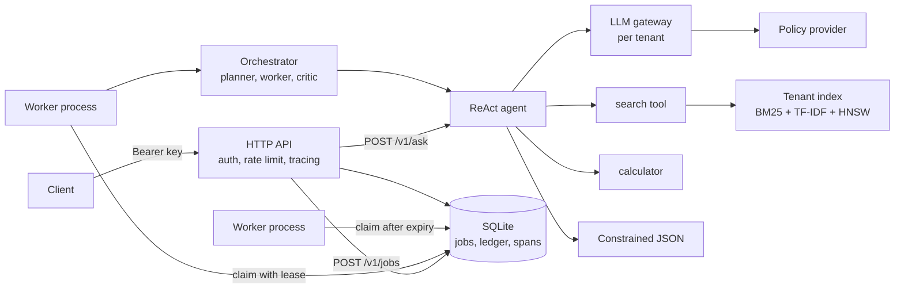

# agent-platform

An authenticated, multi-tenant AI service that answers questions from each tenant's own
documents and runs multi-step research jobs that survive worker crashes. It is the
integration of eight libraries I wrote separately (a safety gateway, a ReAct agent, a
multi-agent orchestrator, hybrid retrieval, an HNSW index, constrained decoding, an
evaluation harness, and a tracing library) into one system with an HTTP API, SQLite-backed
durable state, per-tenant isolation, tracing, metrics, and an evaluation suite. Everything
runs offline and deterministically with the standard library plus those eight packages.

[](https://github.com/adeoluo/agent-platform/actions/workflows/ci.yml)

## Architecture



The request path and the job lifecycle are described step by step, with sequence and state
diagrams, in [docs/ARCHITECTURE.md](docs/ARCHITECTURE.md). Design decisions are recorded in
[docs/adr](docs/adr).

## How the libraries compose

| Component | Library | Role in the platform |
| --- | --- | --- |
| Safety gateway | [llm-gateway](https://github.com/adeoluo/llm-gateway) | Every model call goes through a per-tenant `Gateway`: injection screening (including retrieved text), PII redaction in and out, output policy, response cache. `TenantRateLimiter` enforces per-tenant API quotas. |
| Agent loop | [react-agent](https://github.com/adeoluo/react-agent) | `ReActAgent` drives tool use with a tenant-bound `ToolRegistry` (knowledge-base search and the library's AST-based `CalculatorTool`). |
| Durable jobs | [multi-agent-orchestrator](https://github.com/adeoluo/multi-agent-orchestrator) | Planner, worker, and critic for research jobs. The `Blackboard` snapshot is the checkpoint that a replacement worker restores. |
| Retrieval | [hybrid-rag](https://github.com/adeoluo/hybrid-rag) | Sentence chunking and `HybridRetriever` fusing BM25, TF-IDF, and the HNSW retriever by reciprocal rank fusion. |
| Vector search | [ann-vector-search-library](https://github.com/adeoluo/ann-vector-search-library) | `HNSW` index over hashed embeddings, adapted to the `hybrid_rag` retriever protocol. |
| Structured output | [constrained-generation-library](https://github.com/adeoluo/constrained-generation-library) | Compiles a response schema to an automaton and decodes JSON that is valid by construction. |
| Evaluation | [evaluation-harness](https://github.com/adeoluo/evaluation-harness) | `Runner`, `Task`, and `IncludesGrader` run the fixed question set through the public API, with bootstrap confidence intervals. |
| Tracing | [llm-observability](https://github.com/adeoluo/llm-observability) | `Tracer` spans for requests, agent runs, model calls, tools, and job steps, persisted per tenant and retrievable by id. |

Interface mismatches are bridged by small adapters in this repository (for example
`GatewayModel` turns the gateway into a `react_agent` language model). The libraries are
used unmodified, as git dependencies pinned in `uv.lock`.

## Quickstart

Requires Python 3.11+ and [uv](https://docs.astral.sh/uv/).

```bash
uv sync
uv run agent-platform demo        # everything below, end to end, on a scratch database
```

Or step by step, in separate terminals:

```bash
export AGENT_PLATFORM_KEY_PEPPER="change-me"          # used to hash API keys
uv run agent-platform keys create --tenant acme       # prints the key once
uv run agent-platform serve                           # http://127.0.0.1:8080
uv run agent-platform worker                          # run as many as you like

export AGENT_PLATFORM_API_KEY="ap_..."                # from keys create
uv run agent-platform ingest ./my-docs                # .md, .txt, or .json files
uv run agent-platform ask "How many days do customers have to request a refund?"
uv run agent-platform jobs submit -q "How long is the warranty?" -q "What is 17 * 23?"
uv run agent-platform eval                            # eval suite on an in-process server
```

Configuration is through `AGENT_PLATFORM_DB`, `AGENT_PLATFORM_HOST`, `AGENT_PLATFORM_PORT`,
`AGENT_PLATFORM_KEY_PEPPER`, `AGENT_PLATFORM_RATE_CAPACITY`, `AGENT_PLATFORM_RATE_REFILL`,
`AGENT_PLATFORM_LEASE_SECONDS`, `AGENT_PLATFORM_POLL_INTERVAL`, and
`AGENT_PLATFORM_MAX_ATTEMPTS`.

## API reference

Authenticated endpoints take `Authorization: Bearer <key>` (or `X-API-Key: <key>`). Errors
are JSON objects with `error` and `message`. Every authenticated response carries an
`X-Trace-Id` header.

| Method and path | Auth | Description |
| --- | --- | --- |
| `GET /health` | no | Liveness: `{"status": "ok"}` |
| `GET /ready` | no | Readiness: 200 when the database answers, else 503 |
| `GET /metrics` | no | Prometheus text: requests, latency histograms, auth failures, rate limiting, gateway counters, job counts |
| `POST /v1/ingest` | yes | `{"documents": [{"id", "text", "metadata"?}]}`. Upserts into the caller's knowledge base. Returns `{"ingested", "kb_version"}` |
| `POST /v1/ask` | yes | `{"question", "response_schema"?}`. Returns `answer`, `citations`, `grounded`, `sources`, `steps`, `model_calls`, `cached_calls`, `trace_id`, and `structured` when a schema is given |
| `POST /v1/jobs` | yes | `{"kind": "research", "questions": [...], "step_delay_seconds"?}`. Returns 202 with `job_id` and the job's `trace_id` |
| `GET /v1/jobs/{id}` | yes | Status, attempts, steps completed and total, the step ledger (with the worker that recorded each step), result, error |
| `GET /v1/traces/{id}` | yes | Spans in the `llm_observability` export format plus a rendered tree |

Status codes: 400 invalid input, 401 missing, malformed, invalid, or revoked key, 404 unknown
route or an id that is not the caller's, 405 wrong method, 411 missing length, 413 body over
2 MB, 422 refused by the gateway (prompt injection or output policy), 429 tenant rate limit
(with `Retry-After`).

A response schema is an ordered list of typed properties:

```json
{"properties": [
  {"name": "answer", "type": "string", "max_length": 80},
  {"name": "source", "type": "string", "max_length": 40},
  {"name": "confidence", "type": "enum", "values": ["high", "low"]}
]}
```

Supported types are `string`, `integer`, `number`, `boolean`, and `enum`. Known field names
(`answer`, `source`, `citations`, `grounded`, `confidence`) are filled from the agent result.

## Durability and recovery

Jobs are rows in SQLite. Workers are separate processes that share the database file.

* **Claiming** is a single `BEGIN IMMEDIATE` transaction that takes the oldest queued job,
  or a running job whose lease has expired, and stamps it with the worker id, a lease
  expiry, and a new fencing token.
* **Heartbeats** renew the lease every third of its duration while a step runs.
* **Checkpoints** write the step's output to the ledger and the orchestrator's blackboard
  snapshot to the job row in one transaction, only if the worker still holds the lease with
  the same token.
* **Recovery.** When a worker dies its lease lapses, another worker claims the job with a
  higher token, restores the blackboard, and continues at the first incomplete step.
  Writes from the old owner are rejected by the token check.
* **Poison jobs** are failed after `max_attempts` claims instead of looping forever.

Tested behaviour (`tests/test_crash_recovery.py`): a real worker process is SIGKILLed after
it has checkpointed at least one step of a five-step job. A replacement process finishes
the job. The test asserts against SQLite that the ledger has each step exactly once in
order, that steps checkpointed before the kill were executed exactly once (by the killed
worker), that later steps carry the replacement's token, that the replacement claimed only
after the old lease expired, that the job trace contains spans from both processes, and that
the final result equals an uninterrupted run on a separate database. A slower soak test
kills three successive workers on one 13-step job.

Limits:

* Recording is exactly once; execution is at least once. The step that was running when a
  worker died runs again. Steps here are read-only, but steps with external side effects
  would need idempotency keys.
* Recovery takes at least the remaining lease time.
* Single node. SQLite must be on a local disk (its locking is not reliable on network file
  systems), and there is no replication or failover for the database itself.
* Throughput of job claims is bounded by SQLite's single writer.

## Security model

* **API keys** are `ap_<key_id>_<secret>` with a 256-bit secret. Only
  `HMAC-SHA256(pepper, secret)` is stored; the pepper is an environment variable and is not
  in the database. Verification is constant time and computes a digest even for unknown
  ids. Keys can be listed (without secrets) and revoked.
* **Tenant identity** comes only from the key row. Request bodies cannot name a tenant.
* **Tenant isolation** is structural: each tenant has its own retriever built from its own
  rows, its own gateway cache, its own rate-limit bucket, and tenant-filtered queries for
  jobs and traces. A foreign job or trace id returns 404. Tests assert this through the API
  with overlapping content.
* **Model safety**: the gateway screens the whole prompt, so instructions planted inside an
  ingested document are caught when they are retrieved (tested), and PII is redacted from
  prompts and outputs.
* **Input bounds**: request bodies, documents, questions, schemas, and job sizes are capped.

Limits: there is no TLS (run it behind a reverse proxy), no key expiry or scopes, no
per-key quotas (quotas are per tenant), `/metrics` is unauthenticated and includes tenant
names as labels, the injection detector is pattern based and can be evaded, and isolation
is logical within one process and one database file, not physical.

## Evaluation results

`uv run agent-platform eval` starts an in-process server, ingests the fixed corpus in
`src/agent_platform/corpus.py` for a fresh tenant, and asks 20 questions through
`POST /v1/ask`: 15 answerable from the documents, 3 arithmetic, and 2 not answerable from
the documents.

| Metric | Result |
| --- | --- |
| Accuracy (substring match) | 95.0% (19 of 20), bootstrap 95% CI 85.0% to 100.0% |
| Retrieval questions | 93.3% (14 of 15) |
| Arithmetic questions | 100% (3 of 3) |
| Unanswerable questions answered "could not find" | 100% (2 of 2) |
| Retrieval answers that cite a source | 100% |
| Retrieval answers citing the expected document | 100% |
| Client latency p50 / p95 / p99 | 7.1 / 12.2 / 12.3 ms |

The one miss is real and left in: the `hybrid_rag` sentence chunker splits on every
period, so "TLS 1.3." becomes "TLS 1. 3." and the extracted answer is truncated to
"TLS 1.". The cited document is still correct. The answers are extractive (see
[ADR 0004](docs/adr/0004-offline-policy-model-behind-the-gateway.md)), so these numbers
measure retrieval, grounding, and the request path, not generative quality. The set is
small and was written alongside the corpus, so it is a regression check, not a benchmark
of general ability.

## Benchmarks

Measured on an Apple M1 (8 cores) that was shared with other heavy workloads at the time
(load average above 100), so treat the numbers as conservative and noisy.

**Load** (`uv run python benchmarks/load.py`): the server runs as its own process; 20
tenants each with their own key and corpus; 16 client threads send 2,000 `POST /v1/ask`
requests per pass over loopback. One warm-up request per tenant builds its index first.

| Pass | Requests | Throughput | p50 | p95 | p99 | Errors |
| --- | --- | --- | --- | --- | --- | --- |
| Repeated questions (gateway cache hits) | 2,000 | 293.5 req/s | 44.7 ms | 94.1 ms | 116.1 ms | 0 |
| Unique questions (every model call misses) | 2,000 | 184.3 req/s | 82.8 ms | 122.7 ms | 196.8 ms | 0 |

Every request runs the full path: key verification against SQLite, rate limiting, the
agent loop with two gateway calls, hybrid retrieval, and a trace write. The server is a
single Python process, so throughput is bounded by the GIL. Moving SQLite writes behind an
in-process lock (instead of SQLite's sleep-and-retry busy handler) cut the p99 of the cached
pass from about 1.3 s to about 0.13 s in earlier runs.

**Recovery** (`uv run python benchmarks/recovery.py`): five trials per lease duration. Each
trial kills a worker with SIGKILL right after its first checkpoint of a five-step job (0.2 s
per step) and immediately starts a replacement process.

| Lease | Reclaim after kill (mean / max) | Job complete after kill (mean / max) | Checkpointed steps re-executed |
| --- | --- | --- | --- |
| 0.5 s | 0.51 s / 0.52 s | 1.39 s / 1.49 s | 0 |
| 1.0 s | 1.01 s / 1.02 s | 1.86 s / 1.87 s | 0 |
| 2.0 s | 2.01 s / 2.02 s | 2.86 s / 2.88 s | 0 |

Reclaim time tracks the lease duration, as designed: the kill lands just after a
checkpoint renewed the lease, so the replacement waits out nearly the whole lease. The
remaining time is the four remaining steps (0.8 s) plus process start-up.

## Development

```bash
make all            # ruff format check, ruff lint, mypy --strict, tests with coverage gate
make test-all       # includes the slow soak test
make demo
make bench-load bench-recovery
```

CI runs on Python 3.11 and 3.12: format check, lint, `mypy src` in strict mode, and
`pytest -m "not slow"` with an 80% coverage gate. The suite has 100 tests (99 in CI) and
runs in under 30 seconds locally, including the cross-process crash-recovery and
four-process concurrency tests. Test data is written under `.pytest-work/` in the
repository rather than a system temporary directory.

## Limitations

* The model is a deterministic extractive policy, not a language model. Swapping in a hosted
  provider is a one-line change in `TenantGateways`, but it has not been evaluated here.
* The hashed embedding used for HNSW is lexical, not semantic, so paraphrases with no shared
  words or character trigrams are not matched.
* Indexes are in memory per process and rebuilt from SQLite when a tenant's documents
  change. Very large tenants would need an on-disk index.
* One job kind (`research`) exists. There is no cancellation, priority, or scheduling
  fairness between tenants for jobs.
* Gateway counters in `/metrics` are per server process; worker processes do not export
  metrics.
* Single node, single SQLite file, as described above.

## Roadmap

* PostgreSQL backend for jobs with `FOR UPDATE SKIP LOCKED`, keeping the same fencing
  protocol and tests.
* Job cancellation and per-tenant job quotas.
* A hosted model provider behind the gateway with an evaluation comparison against the
  extractive policy.
* Worker metrics endpoint and trace export in OpenTelemetry format.
* Key scopes and expiry.

## License

MIT. See [LICENSE](LICENSE).
