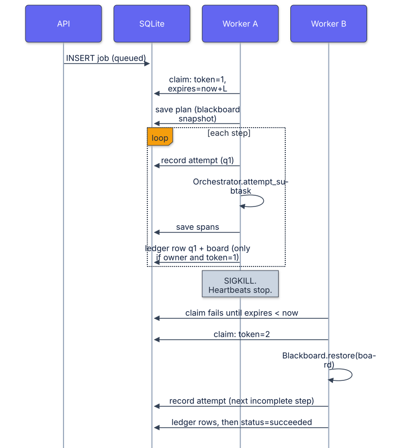

# Architecture

This document describes how a request and a job move through the platform, which library
does what at each stage, and where state lives.

## Components

| Module | Responsibility |
| --- | --- |
| `api.py` | Threaded `http.server` front end: routing, authentication, rate limiting, request tracing, JSON errors, `/metrics` |
| `auth.py` | API key issuance, HMAC-SHA256 hashed storage, constant-time verification, revocation |
| `knowledge.py` | Tenant documents in SQLite, per-tenant hybrid retrievers rebuilt when the tenant's `kb_version` changes |
| `vectors.py` | Hashed embeddings indexed in an HNSW graph, exposed as a `hybrid_rag` retriever |
| `model.py` | Deterministic ReAct policy provider, per-tenant `llm_gateway.Gateway` instances, and the adapter that makes the gateway look like a `react_agent` language model |
| `agent.py` | `AgentRuntime.ask`: the single code path that answers a question for the API and for job workers |
| `structured.py` | Schema-constrained JSON output through `constrained_generation_library` |
| `jobs.py` | Job table, lease protocol with fencing tokens, step ledger, execution log, claim history |
| `orchestration.py` | Planner, worker, and critic for `multi_agent_orchestrator` research jobs |
| `worker.py` | Worker loop: claim, heartbeat, restore blackboard, execute one step, checkpoint, repeat |
| `tracing.py` | Persists `llm_observability` spans per tenant so traces can span processes |
| `evaluation.py` | Eval suite on `evaluation_harness`, driven through the public API |
| `metrics.py` | Prometheus text exposition |

All state is in one SQLite database file in WAL mode. The API server and any number of
worker processes open it independently.

## Request path

  

Legend: amber = entry points and external systems, indigo = core logic, green = data and state, blue = validation and control, grey = observability and outputs.

1. `api.py` reads the `Authorization: Bearer` (or `X-API-Key`) header and calls
   `KeyStore.verify`. The tenant comes from the stored key row. Request bodies never carry
   a tenant.
2. The tenant's token bucket (`llm_gateway.TenantRateLimiter`) is charged one unit.
3. A fresh `llm_observability.Tracer` opens an `http.request` span. Nested spans are added
   by the agent run, each model call, each tool call, and structured decoding.
4. `AgentRuntime.ask` runs a `react_agent.ReActAgent` with two tools bound to the tenant:
   `search_knowledge_base` and `calculator`. The agent's language model is `GatewayModel`,
   which sends every prompt through the tenant's own `llm_gateway.Gateway`. The gateway
   screens the full prompt (including retrieved document text) for injection, redacts PII
   in both directions, checks output policy, and caches responses per tenant.
5. The answer's `[doc_id]` citations are checked against the passages retrieved during the
   same run. `grounded` is true only when every citation names a retrieved document.
6. With a `response_schema`, the result is re-emitted under a token-level automaton so the
   JSON always matches the schema.
7. Spans are written to SQLite under the tenant, and the response carries the `trace_id`.

## Durable job lifecycle

  

Legend: amber = entry points and external systems, indigo = core logic, green = data and state, blue = validation and control, grey = observability and outputs.

  

### Tables

| Table | Purpose |
| --- | --- |
| `jobs` | One row per job: status, payload, blackboard snapshot, result, lease owner, lease expiry, fencing token, attempt count |
| `job_steps` | The step ledger. Primary key `(job_id, subtask_id)` and unique `(job_id, seq)`, so a step can be recorded once |
| `step_attempts` | Every step execution start, with worker and token. Used to prove which steps ran more than once |
| `job_claims` | Every claim, with worker, token, and lease window |
| `spans` | Trace spans as JSON, keyed by `(trace_id, span_id)` and tagged with the tenant |

### Why it recovers correctly

* **Mutual exclusion.** A claim reads and updates the job row inside `BEGIN IMMEDIATE`,
  which takes SQLite's write lock before the read. Two claimers serialize; the second sees
  the job as `running` with a live lease and skips it.
* **Fencing.** Every write a worker makes after claiming (attempt log, checkpoint, finish)
  checks `lease_owner` and `lease_token` in the same transaction. A worker that was paused
  past its lease and then wakes up cannot write anything once another worker has claimed.
* **Atomic checkpoints.** The ledger row and the new blackboard snapshot are committed
  together, so the board never claims progress the ledger does not have, or the reverse.
* **Resume point.** The blackboard snapshot is the `multi_agent_orchestrator` run state.
  `Blackboard.restore` plus `ready_subtasks()` yields exactly the first incomplete step.
* **Determinism.** Workers and the policy provider are deterministic, so a resumed job
  produces the same result as an uninterrupted one. The crash-recovery test checks this.

### What is and is not guaranteed

* Recording is exactly once per step. Execution is at least once: a step that was running
  when its worker died runs again under the new owner. Steps with external side effects
  must therefore be idempotent. In this platform the steps are read-only agent runs.
* Recovery time is bounded below by the remaining lease. Shorter leases recover faster but
  need heartbeats that are not starved; the heartbeat renews every third of the lease.
* All guarantees assume one SQLite file on a local disk. SQLite locking is not reliable on
  network file systems, and there is no replication.
